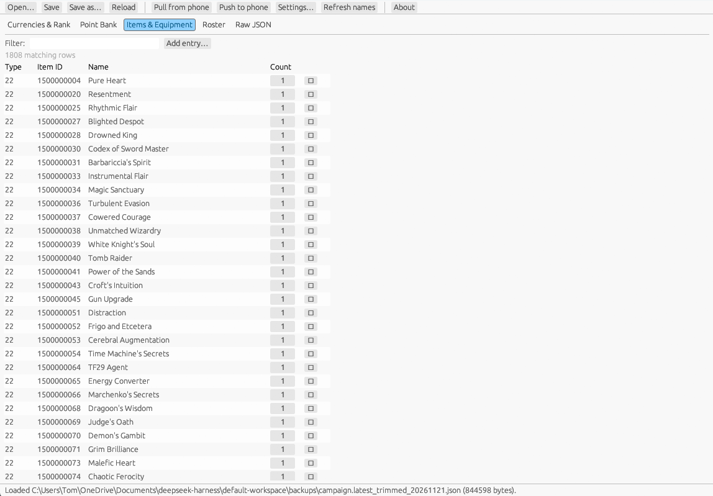
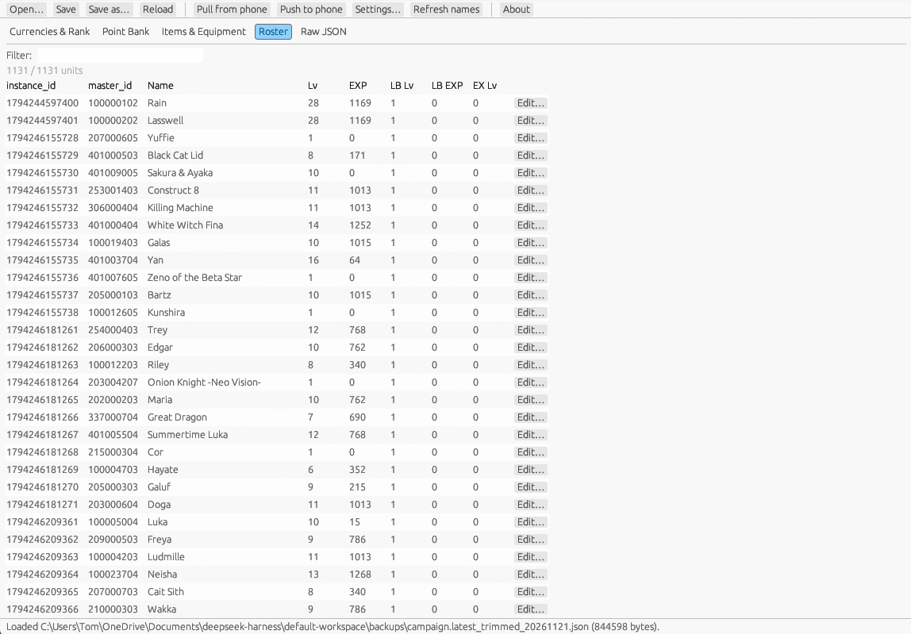
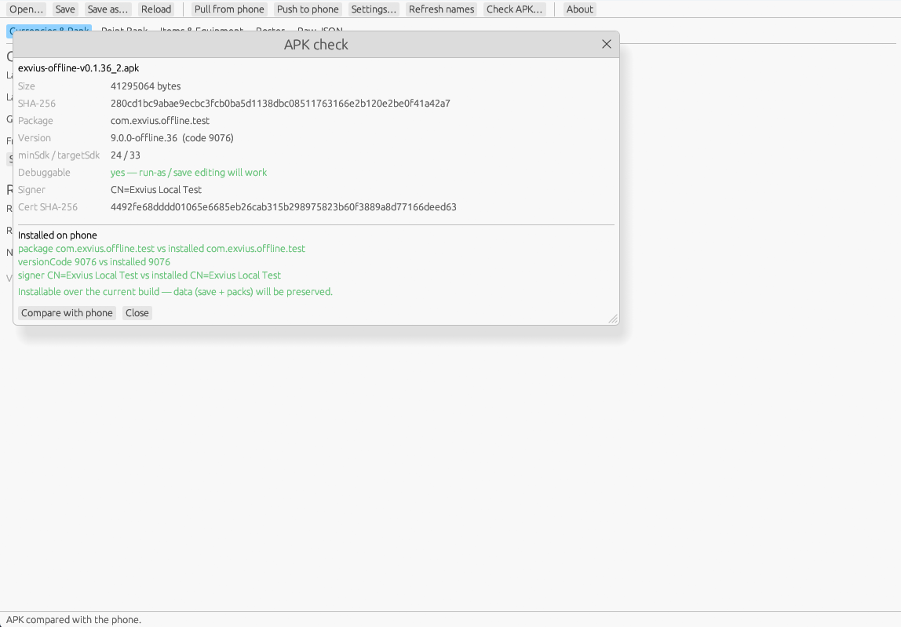

# FFBE Offline Save Editor

A small Windows desktop editor for `campaign.json` from **Exvius Offline** (the FFBE offline fan build, package `com.exvius.offline.test`).

Written in Rust with [egui/eframe](https://github.com/emilk/egui) — a single self-contained `.exe`, no runtime, no installer.



## Features

| Tab | What it does |
|---|---|
| **Currencies & Rank** | lapis free/paid, gil, friend points, rank level/EXP/NRG |
| **Point Bank** | the per-unit enhancement bank (`exvius_unit_points.banks["0"]`): EXP, LB EXP, stat-pot points, EX stat limits — with 90 %/max/zero presets |
| **Items & Equipment** | search by **name**, edit counts, add entries, remove entries; items, materia and equipment in one list |
| **Roster** | search by name / instance / master id, edit level/EXP/LB/EX, **add unit**, **clone unit** |
| **Raw JSON** | full-file editor with validation |

Plus:

- **Automatic backups** — every save writes `campaign.json.<timestamp>.bak` next to the file.
- **Phone pull/push** — reads/writes the save over `adb` + `run-as` (requires a *debuggable* build; no root).
- **APK check** — pick an APK and it reports package, versionCode, minSdk, **debuggable**, signer certificate and SHA-256; "Compare with phone" tells you whether it would install over the current build without wiping data.
- **Name cache** — item/unit names come from the game's master tables; `Refresh names` pulls them from the phone and caches them in `%APPDATA%\ExviusSaveEditor\names.json`.



## Build

Requires a Rust toolchain (stable). On Windows with the GNU or MSVC target:

```powershell
cargo build --release
# target\release\exvius-save-editor.exe
```

Dependencies: `eframe`, `serde_json`, `rfd`, `sha2`.

## Usage

1. `File → Open` a `campaign.json` (or use **Pull from phone**).
2. Edit, then **Save** (a `.bak` is written first).
3. **Push to phone** to copy it back and restart the game.

The save is plain JSON with no signature or checksum; the editor only writes the file you opened.

### Phone setup

`Pull from phone` / `Push to phone` use adb and `run-as`, which work only when the installed APK is debuggable. Set the adb path and package under **Settings…** (defaults: MuMu adb, `com.exvius.offline.test`).

## Safety notes

- No network access, no telemetry, no elevation.
- The only subprocesses spawned are `adb`, `aapt2` and `apksigner` (for the APK check); the APK check never modifies an APK.
- Temporary files (push staging, pulled APK) are created per-operation and deleted afterwards.
- Keep your `.bak` files — the editor validates JSON, not game semantics.



## Layout

```
src/main.rs      entire application (~2k lines, single file)
Cargo.toml       dependencies
docs/            screenshots
```
